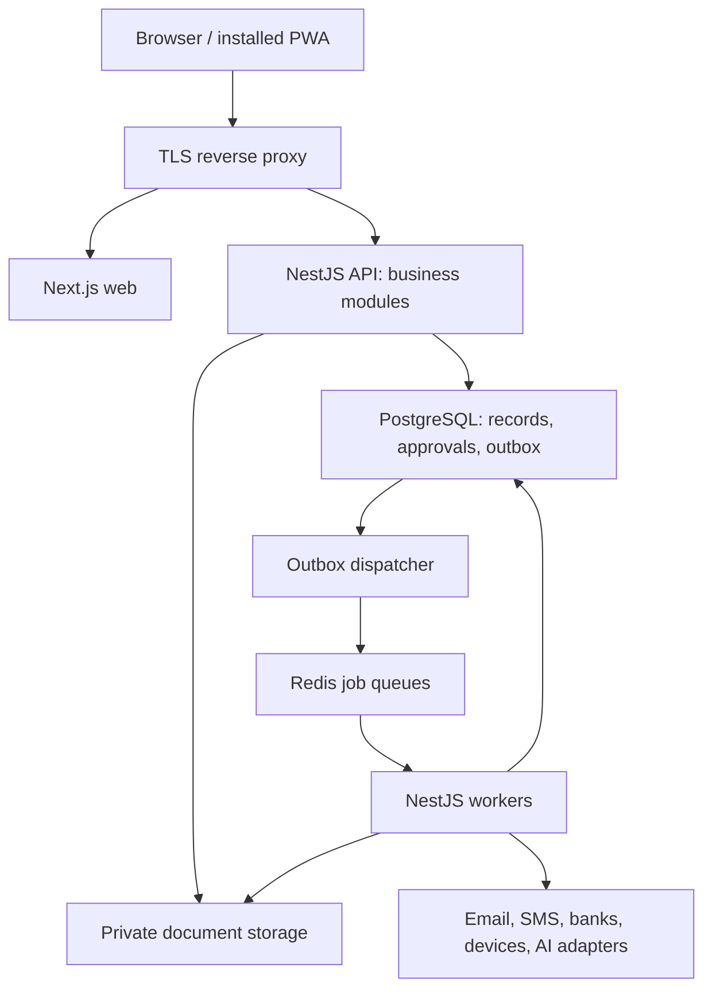
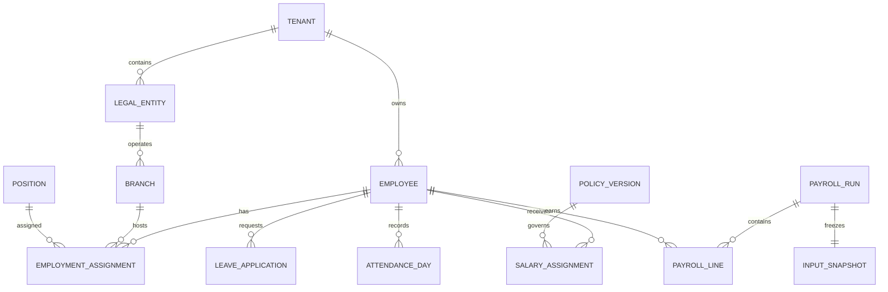
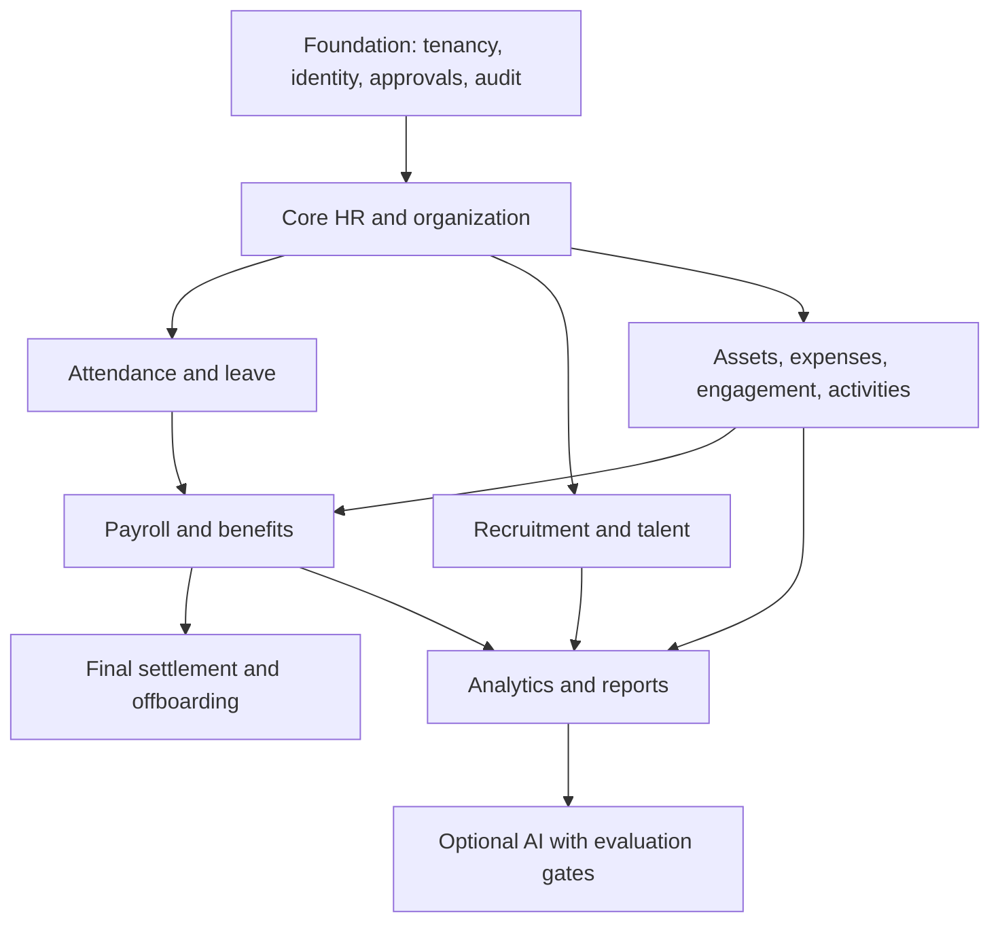

# Advanced HRIS System — Implementation Plan and Architecture

Version 1.0 • 12 November 2026 • Planning baseline

## 1. Scope and delivery decision

This plan translates `advanced-hris-system-prompt.md` into an implementable product roadmap. It covers all requested modules; later phases are deferred delivery, not removed scope. No software, integrations, legal compliance, or performance capacity is represented as implemented or certified by this document.

Build a TypeScript modular monolith: Next.js web/PWA, NestJS API and worker, PostgreSQL, Redis/BullMQ, and private S3-compatible storage. Keep one authoritative business backend. Start with a deployable Core HR release, then operational payroll, advanced HR, analytics, and optional AI. Security, localization, accessibility, and tests begin with the foundation rather than waiting for the final phase.

Planning assumptions: SaaS with multiple independent tenants; a tenant can contain multiple legal entities and branches; initial currency BDT and default timezone Asia/Dhaka; English and Bangla; a small product team; self-hostable Docker delivery. Hosting region, actual tenant sizes, bank/device vendors, and statutory applicability remain discovery inputs. Dedicated tenant databases are a future deployment option, not an initial requirement.

## 2. Industry benchmark and product implications

Initial public-document research, not a hands-on procurement evaluation. Features can depend on edition, country, and integration contracts. The matrix compares documented focus areas, not unsupported completeness scores. Links are primary vendor sources. Detailed usability trials and Bangladesh compatibility checks remain Phase 1 tasks.

| Platform / source | Documented focus to benchmark | Design implication for this HRIS | Validation boundary |
|---|---|---|---|
| [Workday HCM](https://www.workday.com/en-us/products/human-capital-management.html) | Connected HCM and skills/talent capabilities | Shared employee record and reusable skills catalog | Do not infer Bangladesh statutory payroll support |
| [SAP Employee Central](https://www.sap.com/products/hcm/employee-central-hris/features.html) | Unified worker data, self-service, organizational structures, reporting | Effective-dated employment and role-specific employee views | Enterprise configuration needs pilot usability testing |
| [Oracle HR](https://www.oracle.com/human-capital-management/hr/datasheet/) | Positions, approvals, delegation, benefits, organizational modeling | Separate positions from people; configurable approval definitions | Country localization must be verified separately |
| [BambooHR](https://www.bamboohr.com/platform/) | Connected employee lifecycle and HR administration | Simple employee profile and lifecycle navigation | [Payroll geography](https://www.bamboohr.com/platform/payroll/) is not evidence of local statutory coverage |
| [Rippling](https://www.rippling.com/platform) | Shared workflows, reporting, permissions across HR/IT/finance | Shared approval engine and asset/offboarding orchestration | Device automation requires provider-specific permissions |
| [Zoho People](https://www.zoho.com/people/features.html) | HR services, customization, employee query handling | Custom forms and HR service requests | Confirm edition and separate-product dependencies |
| [ADP Workforce Now](https://www.adp.com/what-we-offer/products/adp-workforce-now/capabilities) | Connected payroll, HR and benefits | Payroll reconciliation and finance review workspace | Local tax and bank support cannot be assumed |
| [Gusto payroll](https://gusto.com/product/payroll/features) | Payroll and approved expense reimbursement | Approved claims feed controlled payroll inputs | Foreign tax automation is not a Bangladesh rules source |
| [UKG Pro](https://www.ukg.com/products/ukg-pro) | HCM and workforce management suite | Treat scheduling and time operations as a major domain | Device and regional capability need validation |
| [OrangeHRM](https://orangehrm.com/open-source/upgrade-to-advanced) | Modular HR, recruitment, performance, payroll integration | Clear module activation and integration boundaries | Starter and Advanced capabilities differ |
| [greytHR](https://www.greythr.com/help-admin/know-more-greythr/feature-comparison-starter-essential/) | Payroll controls and employee portal | Payroll period locks and practical ESS workflows | Regional compliance must be separately reviewed |

Original product differentiation: configurable institution profiles, Bangladesh effective-dated rules, bilingual documents, explainable payroll, transparent activity reporting, and permission-aware HR assistance. Do not copy vendor branding or proprietary interfaces.

## 3. Technology decisions

| Layer | Selection | Rationale / constraint |
|---|---|---|
| Web | Next.js, React, TypeScript | Public career/product pages plus authenticated responsive application; backend rules stay in NestJS |
| UI | Tailwind, shadcn/ui, React Hook Form, Zod | Reusable accessible components and consistent form validation |
| Client data | TanStack Query | Server-state cache, mutations and invalidation; keep salary data out of persistent client caches |
| Charts | Apache ECharts | Common KPI, trend, heatmap, funnel and comparison views; accessible table equivalents |
| Backend | NestJS, REST `/api/v1`, OpenAPI | Explicit modules and dependency injection; one TypeScript business stack |
| Persistence | PostgreSQL with Prisma; reviewed SQL migrations | Relational integrity; SQL for RLS, exclusion constraints, reporting and locking beyond ORM abstractions |
| Jobs | BullMQ with Redis; PostgreSQL outbox | Separate worker deployment; durable DB intent and retryable execution |
| Files | Private S3-compatible storage | Versioned documents, short-lived downloads, quarantine scanning |
| Authentication | Server-managed sessions; Argon2id; MFA | Revocation and secure web cookies; OIDC SSO adapter later |
| AI retrieval | PostgreSQL vector extension when enabled | Avoid another datastore initially; tenant and document ACL filtering mandatory |
| Operations | Docker Compose, reverse proxy, CI/CD, OpenTelemetry | Reproducible local setup, deployable services and measurable behavior |
| Tests | Unit runner, real PostgreSQL integration tests, Playwright | Verify arithmetic, transactions, permissions and complete UI journeys |

Pin supported compatible releases during foundation setup and record an upgrade policy. This document does not prescribe unverified future version numbers. NestJS documents queue integration at https://docs.nestjs.com/techniques/queues.

## 4. Runtime architecture

The web app renders screens and calls the API; it does not write business tables directly. Each module owns its writes, validations, repositories and domain events. Cross-module commands use defined application services; analytics may use approved read projections. Prevent circular module dependencies through automated boundary checks.

Within each module: transport/controllers → application use cases → domain rules → infrastructure adapters. Shared packages contain contracts, money/date primitives, UI, localization and infrastructure utilities, not a giant shared business service.

Deploy web, API and workers independently from one repository. API replicas are stateless except external session storage. Workers can scale by queue. Extract a service only when measured resource contention, ownership or security requirements justify it.

### Repository layout

| Path | Responsibility |
|---|---|
| `apps/web` | Public site, careers/candidate portal, ESS, manager and HR applications |
| `apps/api/src/modules` | Identity, tenancy, organization, people, attendance, leave, payroll and other domain modules |
| `apps/worker` | Job dispatch, reports, notifications, imports, payroll calculation, scanning and AI |
| `packages/contracts` | OpenAPI-derived DTO/client contracts and event schemas |
| `packages/ui`, `packages/i18n` | Design system and English/Bangla resources |
| `packages/domain` | Tested shared primitives with limited scope |
| `database/migrations`, `database/seeds` | Reviewed schema/RLS changes and explicit demo-only seeds |
| `tests/integration`, `tests/e2e`, `tests/load` | Cross-module, workflow, security and capacity checks |
| `infra`, `docs` | Compose, deployment, runbooks, ADRs and user manuals |

## 5. Tenancy, authorization and configuration

Tenant is the isolation boundary. A tenant contains legal entities, branches, departments, positions and employee assignments. A global user can have multiple tenant memberships; employee records and permissions remain tenant-specific. Candidate identities have a separate restricted portal scope.

Every tenant-owned record carries `tenant_id`. Resolve tenant context from an authenticated membership and verified routing context, never trust a client header alone. Enforce tenant predicates in application repositories and PostgreSQL row-level security. Use transaction-local tenant context on the same pooled DB connection; missing context denies access. Use a runtime role without ownership, superuser or BYPASSRLS privileges; apply FORCE ROW LEVEL SECURITY where appropriate and separate migration credentials. PostgreSQL documents the bypass caveats at https://www.postgresql.org/docs/current/ddl-rowsecurity.html.

Use tenant-qualified unique keys and composite foreign keys `(tenant_id, parent_id)` to prevent cross-tenant associations. Apply the same boundary to worker payloads, report files, search/vector queries, object metadata, cache keys and notifications. Authorize again when a background export executes and when it is downloaded.

Authorization combines role permissions with organization scope and field permissions: action + resource + self/team/branch/department/tenant scope + sensitive-field grants. A manager role does not automatically grant salary, NID, medical records or grievance access. Seed every requested default role as a configurable template. Payroll preparation and approval must be separated. Delegations expire and cannot expand the delegator's authority. Platform super administrators manage tenant service state; access to HR records requires explicitly granted, time-limited, audited support access.

Module flags affect API authorization, navigation, jobs and integrations together. Dependency checks block disabling a prerequisite while active workflows depend on it. Historical records remain readable to authorized users under documented archival behavior.

Institution templates configure rules, hierarchy, custom fields, schedules and modules; do not create a separate code fork per industry. Ship reviewed starter templates for SME/IT, education, NGO, healthcare, manufacturing/garments and retail; extend to all listed organization types through configuration and validated domain requirements. Government or sector-specific pay rules require their own reviewed policy packs.

## 6. Data model and integrity rules

| Domain | Principal entities | Key invariant |
|---|---|---|
| Platform | Tenants, LegalEntities, OrganizationSettings, ModuleEntitlements, Subscriptions | Tenant status and entitlements enforced server-side |
| Access | Users, Memberships, Roles, Permissions, RolePermissions, UserRoles, ScopeGrants, Sessions, Delegations | Scoped grants never escape membership |
| Organization | Branches, Departments, Positions, Designations, JobGrades, PositionBudgets | No hierarchy cycles; date-aware assignments |
| People | Employees, Contacts, Education, Experience, Dependants, Nominees, Contracts, EmploymentAssignments, EmploymentEvents | Tenant-unique employee number; historical assignments preserved |
| Documents | Documents, DocumentVersions, AccessGrants, Acknowledgements, Templates, ScanResults | Only authorized released versions downloadable |
| Policies | PolicyDefinitions, PolicyVersions, PolicyAssignments, SourceReferences | Approved effective versions; distinguish statutory vs organization rules |
| Time | AttendanceEvents, AttendanceDays, Shifts, ShiftAssignments, Breaks, Corrections, DeviceMappings | Raw events immutable; corrections generate revisions |
| Leave | LeaveTypes, Entitlements, AccrualRuns, LeaveLedger, LeaveApplications, Reservations | Atomic reservation and balance movement |
| Payroll | SalaryStructures, Components, SalaryAssignments, PayrollPeriods, Runs, InputSnapshots, PayrollLines, Payslips, PaymentBatches, Reconciliations | Immutable approved calculation versions; decimal arithmetic |
| Benefits/claims | BenefitPlans, Enrollments, Contributions, Expenses, Loans, Installments, Advances | Approved financial inputs consumed once |
| Recruitment | Requisitions, Jobs, Candidates, Applications, Interviews, Assessments, Offers | Offer-to-employee conversion idempotent |
| Lifecycle | OnboardingCases, OffboardingCases, ChecklistTasks, Clearances, ExitInterviews, Settlements | Settlement and account revocation tracked separately |
| Talent | ReviewCycles, Templates, Reviews, Goals, KPIs, OKRs, Competencies, PIPs | Confidential feedback visibility and versioned scoring |
| Learning | Courses, Programs, Enrollments, Sessions, Assessments, Certificates, Skills, Budgets | Completion evidence retained |
| Productivity | Tasks, Dependencies, Recurrences, TimeEntries, DailyLogs, WeeklyPlans, MonthlyReviews | No dependency cycles; no covert monitoring |
| Engagement | Announcements, Messages, Surveys, Responses, Grievances, Suggestions, Events, Awards | Restricted case access; anonymity rules explicit |
| Assets | Assets, InventoryMovements, Assignments, Returns, Maintenance, Incidents | Exclusive active assignment where applicable |
| Platform services | WorkflowVersions, ApprovalRequests, ApprovalSteps, Notifications, Outbox, JobExecutions, AuditEvents, Imports, ReportDefinitions, ExportJobs, Integrations, AIUsage | Durable, idempotent processing with audit trail |

All business tables use stable IDs, created/updated metadata and concurrency versions where needed. Store instants in UTC and calendar dates as dates; keep timezone and business-day attribution on shift/payroll calculations. Store BDT amounts as fixed-precision decimals and serialize decimals safely; use a decimal library, never binary floating point for payroll. Define rounding by component and final payment policy.

Employment, salary and policy assignments use half-open effective intervals `[from, to)` with overlap prevention for the same assignment scope. Retain recorded-at history as well as effective dates so a retroactive correction can be explained. Rehire creates a new employment episode linked to the existing person, not an overwrite of termination history.

Index tenant plus common filters such as status, employee, branch and date. Use bounded pagination. Plan attendance/audit partitioning only after representative query measurements. Use JSONB for validated custom fields and immutable calculation snapshots, not as a substitute for normalized payroll or employment relationships.

### Core relationship diagram

This is a logical ER view, not the complete physical migration schema. Each domain's detailed ERD, column dictionary, deletion policy and constraints are required before its implementation.

## 7. Shared engines and critical workflows

### Approval engine

Versioned workflow definitions support sequential, parallel and conditional steps, deadline escalation, delegation, rejection comments and resubmission. Build the runtime first, then the visual editor over the same schema. Validate cycles, missing approvers and impossible conditions before publication. An in-flight request retains its workflow version and approver resolution history. Each decision uses a transaction and optimistic concurrency guard. Business state changes and approval completion commit together; notifications are emitted through the outbox. A requester cannot bypass separation of duties through delegation. Rejected requests create a linked revision on resubmission.

### Attendance and leave

Preserve device/web events with provider event IDs and deduplicate per tenant/provider. Resolve cross-midnight shifts against assigned shift instances rather than midnight date boundaries. Store original timestamp, received timestamp, source and evidence quality. Handle missing punches, duplicate punches, split shifts, late arrival, early departure, breaks, holidays, remote schedules and approved overtime explicitly.

Geofencing/QR/IP checks are evidence, not guaranteed proof of presence. Use short-lived signed QR challenges, replay detection and authorized location capture at check-in only. Provide an approved correction path when location or device permission fails. Hardware adapters require vendor protocols and sample events; never claim universal biometric compatibility.

Leave uses a ledger for accrual, carry-forward, reservation, consumption, encashment, adjustment and reversal. Reserve entitlement on submission where configured, then consume or release it atomically. Lock the relevant balance/ledger state to prevent concurrent overspending. Half-days, overlap, holiday exclusion, negative balance rules and retroactive cancellations require explicit tests. Payroll consumes approved leave/attendance revisions at cutoff.

### Payroll and Bangladesh rule governance

Payroll states: Draft → Inputs frozen → Calculated → Reviewed → Approved/Locked → Payment prepared → Reconciled. Rejected calculations return through a new calculation version. Payment status is separate from payroll approval: uploading bank advice is not proof of payment.

Freeze salary assignments, employment dates, attendance revisions, leave, benefits, approved claims/loans and policy versions into an input snapshot. Validate missing inputs before calculation. Calculate per employee using deterministic formulas and explicit proration/rounding policies. Store every component's input, rule version, intermediate amount and explanation. Finance compares totals and variance reports before independent approval. Approved results are immutable; arrears, reversals and off-cycle runs handle corrections. Idempotency keys and database uniqueness prevent duplicate runs, lines and disbursement intents; worker retries cannot generate another payment.

Implement basic/house rent/medical/conveyance allowances, festival/performance bonuses, commissions, incentives, overtime, tax, provident fund, gratuity, insurance, loan/advance deductions, arrears, increments and final settlement through versioned components. Benefit enrollment and contribution tracking are explicit features, not just deduction labels.

Policy records include jurisdiction, industry/category applicability, authority/source URL and document version, effective dates, formula/table, statutory or organizational classification, reviewer, approval date and test cases. Detect conflicting assignments and missing approved rules; block affected payroll instead of silently applying defaults. Never execute administrator-supplied JavaScript or SQL: use a restricted formula language with allowed operations and bounded evaluation.

No current Bangladesh rates or legal conclusions are asserted here. Before loading production policy packs, verify the applicable NBR instruments, gazettes, labour legislation/rules, sector wage orders and privacy/retention obligations with primary sources and qualified reviewers. Source snapshots and approved examples become release evidence.

### Files, notifications and integrations

Uploads: authorize intent → private quarantine → size/type/content validation → scanner result → release or reject. Scanner outage leaves the file quarantined with a visible retry state. Signed URLs are short-lived and issued after authorization. Generate bilingual PDFs using embedded Bangla-capable fonts and verify shaping and layout.

Business transaction + outbox row commit atomically. Dispatcher retries; consumers keep durable deduplication keys and run at least once. Dead-letter handling includes operator review and safe replay. Email/SMS/push providers have delivery records, tenant quotas, retry policies, opt-outs where applicable and template localization. Do not put salary or confidential grievance detail in notification previews.

Adapters cover SMTP, Bangladesh SMS, approved WhatsApp providers, calendar/Workspace/Microsoft 365, biometric/RFID gateways, bank/payment providers, accounting, cloud storage, identity and AI. Signed webhooks include replay protection; outgoing requests have timeout/backoff and SSRF controls. Start bank delivery with validated advice-file export and manual reconciliation; enable live transfer only after contracted API integration and sandbox verification.

## 8. Feature implementation roadmap

Durations below are rough engineering planning ranges, not delivery commitments. They assume three full-time engineers with ongoing QA, UX and HR/payroll expertise, decisions available promptly, and parallel work within stages. Phase 1 re-estimates after pilot scope and integration samples. A solo build takes substantially longer.

| Phase | Features and deliverables | Dependencies | Exit criteria | Indicative duration |
|---|---|---|---|---|
| 1 — Discovery and detailed design | Benchmark validation; source requirement checklist; pilot institution policies; threat model; detailed foundation ERD; API conventions; wireframes; ADRs; backlog | Requirements document | Each requirement has owner/phase/test; institution assumptions and policy review process recorded | 2–3 weeks |
| 2 — Secure foundation | Repository/CI/Compose; tenancy/legal entities; auth, MFA, verification/reset/session controls; all role templates/scopes; branding/themes/i18n; module flags; audit; file pipeline; initial approval runtime; in-app/email; public/auth pages | 1 | Two-tenant isolation tests; employee cannot access HR-only fields; restore smoke test; working sign-in and organization setup | 4–6 weeks |
| 3A — Core HR and organization | Full employee profiles, contacts/family/nominees/IDs/bank details, education/experience, contracts/documents, custom categories, positions/grades/headcount/org chart, transfer/promotion/rehire history; ESS profile approval; CSV/XLSX import; letters and expiry alerts | 2 | Import→hire→profile change→promotion→document retrieval works with history and scoped access | 4–6 weeks |
| 3B — Time and leave | Shifts/flexible/night/rotation, web/mobile punches, QR/GPS/IP, device adapter contract, breaks/overtime/corrections, calendars; all configured leave types/accrual/carry-forward/encashment; team views and approvals | 3A | Cross-midnight fixtures pass; duplicate events harmless; concurrent leave submissions cannot overspend | 4–6 weeks |
| 3C — Payroll and ESS operations | Salary/component/rule engine, reviewed Bangladesh policy packs, benefits/contributions, bonuses/arrears/revisions, tax, loans/advances minimum slice, claims inputs, approvals/payslips/advice/reconciliation, payroll history, settlement kernel | 3B + approved rules | Signed-off golden payroll cases; repeat calculations identical; retries cannot double-pay; pilot reconciles representative payroll periods | 6–9 weeks |
| 4A — Recruitment and lifecycle | Requisitions, careers/candidate portal, CV upload, pipeline/source tracking, interviews/calendars/evaluations/assessments/communications/offers; onboarding checklists/orientation/probation; full offboarding, clearance/assets/exit interviews/letters and final settlement | 3A; 3C for settlement | Candidate→hire→onboard and resignation→clearance→settlement→access revocation work end-to-end | 4–6 weeks |
| 4B — Talent and learning | Configurable reviews, KPI/OKR/goals, self/manager/peer/360 feedback, scoring, competency/PIP/promotion recommendations; courses/resources/enrollment/calendar/exams/certificates/skill matrix/budget/feedback/mandatory training | 3A + approval engine | Full review cycle and training-to-certificate journey; confidential feedback permissions verified | 4–6 weeks |
| 4C — Supporting HR operations | Full expenses/claims/budgets/reimbursements; loans/installments/advances; inventory/assignment/return/maintenance/loss; announcements/messages/directory/recognition/events/surveys/suggestions/grievances; policy publishing/acknowledgements | 3A; 3C financial integration | Approved claim consumed once; restricted grievance access; asset return and policy acknowledgement evidence | 4–6 weeks |
| 5 — Activities, analytics and reporting | Daily logs, weekly plans/reviews, monthly summaries, Kanban/list/calendar/timeline, dependencies/recurrence/priorities/comments/attachments/workload; all requested analytics categories and chart types; authorized report builder/PDF/XLSX/CSV/print/schedules/sharing | Domain data from 3–4 | Metrics reconcile to source; filters/drill-down/export preserve permissions; recurring tasks and reports deduplicate | 5–7 weeks |
| 6 — AI and advanced automation | Authorized RAG; payslip/leave explanations; CV extraction/matching/interview drafts; document drafts/summaries; anomaly/skill/trend analysis; evaluated forecasting/attrition indicators; provider/key/model/quota/audit settings; visual approval builder and advanced escalation | Stable data/ACLs; approval runtime from 2 | Cross-tenant/prompt-injection tests; cited responses; human-reviewed recommendations; predictions gated on evaluation | 4–7 weeks |
| 7 — Cross-platform completion | Manifest/service worker/update flow, install UX, limited offline shell/drafts, push and sync fallbacks, Windows/Android/iOS device testing; Android Capacitor package; optional Windows and iOS store packages | Responsive app from 2 | Device matrix passes installation, camera/location/files/session/logout behavior; offline limitations documented | 3–5 weeks |
| 8 — Production qualification | Full regression, penetration/accessibility/load tests, capacity tuning, failover/restore drills, privacy retention/export/deletion, operational alerts, pilot migrations and UAT | All launch scope | No unresolved critical security/calculation defects; restore targets demonstrated; pilot sign-off | 4–6 weeks |
| 9 — Deployment and handover | Deployable images, env/secrets guide, migrations/rollback, API docs, admin/HR/employee/developer manuals, training and support runbooks | 8 | Reproducible deployment and monitored production acceptance | 1–2 weeks |

Sequential sum is 49–75 team-calendar weeks; parallel delivery may shorten elapsed time, while vendor onboarding and legal review may extend it. Do not commit to the full platform on a short MVP schedule.

Release gates: R1 Core HR after 3A; R2 operational pilot after 3C plus essential onboarding/offboarding; R3 full HR operations after 4; R4 productivity/analytics after 5; R5 AI/platform completion after 6–7; enterprise release after 8–9. Each release ships only completed, functional modules; feature flags hide unfinished work.

### Dependency map

Payroll's Phase 3 includes minimum approved claim/loan contracts; Phase 4 expands their user workflows. Analytics starts with basic domain reports as modules ship; Phase 5 consolidates the full center. PWA groundwork, security and documentation run throughout.

## 9. UX and page implementation

Use one design system with light/dark/system themes, organization branding, readable tables, keyboard navigation, accessible forms and mobile layouts. Test English/Bangla expansion and WCAG 2.2 AA criteria. Server permissions govern navigation and page data; hiding a menu is not authorization.

| Workspace | Pages and interaction focus |
|---|---|
| Public | Landing/features/about/contact/privacy/terms; pricing when subscriptions launch; login/registration/reset; careers and application tracking |
| Employee | Personal dashboard/profile, attendance/calendar, leave, payslips/history, tasks, claims/loans, training/reviews, documents/policies, requests/grievances |
| Manager | Team dashboard, approvals, leave/shift coverage, activities/workload, reviews and recruitment assignments |
| HR | Directory/profile/create/edit, org chart/branches/departments/positions, recruitment/candidates, onboarding/offboarding, attendance/shifts/leave, performance/training, communication/assets |
| Finance | Salary structures, payroll dashboard/processing/payslips, benefits, claims, bank advice and reconciliation |
| Executive | Analytics, workforce planning, headcount/cost/vacancy scenarios, reports and authorized drill-down |
| Administration | Settings, users/roles, policies/forms/workflows, integrations/API keys, notifications, audit, health/backups, subscriptions/module entitlements |
| Shared | Notification center, approval center, report builder, AI assistant and help |

Each screen must include real API integration, validation, loading/empty/error/success states, explicit permission denial, responsive layout and audit-sensitive actions. Contact and notification actions require rate limits. Sensitive profile updates are requests, not immediate edits. Custom forms have versioned schemas, types and field ACLs.

## 10. Analytics and AI architecture

Define a metric catalog before charts: business definition, numerator/denominator, date basis, exclusions, scope, freshness and source. Examples: headcount uses effective assignments; turnover states its average-headcount convention; attendance distinguishes scheduled eligible days from leave/holidays. Display last refreshed time. Start PostgreSQL read projections/materialized summaries, then add a replica/warehouse only when load evidence warrants it.

Provide workforce, payroll, attendance, recruitment, performance, retention and training datasets plus executive contract/retirement/approval alerts. Strategic planning includes headcount budgets, vacancy plans, cost projections and scenario versions. The report builder exposes allowlisted fields, joins, aggregates and filters, not arbitrary SQL. Enforce row/field permissions on interactive views, scheduled executions, exports and sharing. Suppress small sensitive demographic cohorts; avoid letting drill-down expose individuals. Prevent CSV formula injection. Large exports are asynchronous with expiry and access checks.

AI uses server-side provider adapters and secret storage. Only index approved document versions; apply tenant and record ACLs before retrieval and re-check results before generation. Permission changes and document withdrawals invalidate retrieval access immediately. Include citations and abstain when evidence is insufficient. Treat uploaded documents as untrusted data, not executable instructions. Payroll/leave answers use deterministic authorized APIs for amounts and balances.

AI drafts remain drafts; no autonomous candidate rejection, salary modification, performance sanction or termination. Matching uses job-relevant evidence and visible explanations. Predictive features require adequate historical data, leakage-resistant validation, uncertainty and fairness review; absent evidence, show descriptive statistics and mark predictions unavailable. Do not infer protected traits or perform emotion/personality surveillance. Log model/version, authorized source IDs, usage, evaluation and reviewer action with redaction and retention controls.

## 11. Security, reliability and platform limits

Use HttpOnly/Secure/SameSite cookies, CSRF protection for browser mutations, session rotation/revocation and privileged-action MFA. Rate-limit login/reset/OTP/API actions; avoid account enumeration. Apply DTO validation, parameterized queries, output escaping, CSP and strict CORS. Keep credentials out of frontend bundles, repositories and logs. Encrypt storage and backups; additionally protect sensitive identifiers/bank details through managed-key encryption and masking.

Audit records capture tenant, actor/delegation, action, entity, reason, timestamp, request correlation and redacted changes. Restrict append permissions and periodically export integrity-protected audit batches to separately controlled retention storage. A database hash chain alone is not proof against an administrator rewriting both data and hashes.

Backups include PostgreSQL point-in-time recovery plus document versions and key recovery procedures. Proposed pilot goals: RPO ≤15 minutes and RTO ≤4 hours, subject to measured restore drills and infrastructure budget. Tenant-specific restore/export requires a tested selective recovery process; whole-database restore alone is insufficient. Define retention and legal holds by record class; deletion includes files, indexes and backup expiry behavior.

Operational dashboards track API latency/errors, DB pool saturation, queue age/failures, outbox backlog, email failures, scanner availability, payroll failures, storage growth and AI quotas. Use correlation IDs; do not log full HR payloads. Deploy via backward-compatible expand/migrate/contract schema changes with a single migration coordinator and tested rollback/forward-fix plans.

PWA caches static application shell only by default. Do not persist payslips, NID, payroll reports or privileged API responses offline. If low-risk drafts are enabled, label unsent state, set expiry, clear on logout/tenant switch and reauthorize sync. Offline attendance, if enabled later, is pending evidence requiring validation; do not trust device time. Feature-detect push/background sync and provide in-app/email/manual retry fallbacks. Installation differs by platform; see https://developer.mozilla.org/en-US/docs/Web/Progressive_web_apps/Guides/Making_PWAs_installable. Native packaging requires signing, device testing, store accounts and policy review; a PWA is not an App Store release.

## 12. Test plan and measurable acceptance

| Area | Required evidence |
|---|---|
| Tenant isolation | At least two tenants; guessed IDs, imports, workers, downloads, reports, caches, vector retrieval and cross-tenant foreign keys all tested |
| Authorization | Self/team/branch/tenant scopes; restricted salary/medical/grievance fields; stale sessions, delegated authority and separation of duties |
| Concurrency | Two API processes and multiple workers; duplicate payroll/leave/device requests; database-enforced consistency under retries |
| Payroll | HR-approved golden cases for join/leave mid-month, salary revision, unpaid leave, overtime, bonuses, tax policy changes, arrears, loans, PF/gratuity and settlement |
| Time and leave | Night shifts, timezone/date boundaries, missing events, partial leave, overlapping requests, accrual/carry-forward and concurrent reservations |
| Integrations | Provider sandbox/fixtures, signature validation, duplicate/out-of-order events, timeout/retry and reconciliation |
| End-to-end | Hire, transfer, approve leave, attendance correction, payroll/payslip, review, training, resignation and settlement |
| Accessibility and localization | Keyboard/screen-reader checks, contrast, mobile forms, Bangla rendering, bilingual PDF exports |
| Resilience | Kill workers between DB commit and dispatch, replay outbox, scanner outage, Redis recovery, expired links and backup restoration |
| AI | Unauthorized retrieval, document prompt injection, missing evidence, fabricated amounts, revoked access and quota enforcement |

Proposed pilot load fixture: 10 tenants, largest 10,000 employees, 200 concurrent active users and representative year-long attendance history. On an explicitly recorded test environment, target ordinary API p95 under 500 ms, usable dashboard within 3 seconds on the agreed network/device, 10,000-employee payroll calculation within 15 minutes, and p95 routine queued notifications dispatched within 60 seconds excluding provider delivery. These are test objectives, not measured claims. Record throughput, error rate, hardware, query plans and workload mix; revise before contractual SLAs.

Definition of done for each feature: schema migration + domain rules + scoped API + UI + audit + notifications where applicable + meaningful tests + operational failure behavior + documentation. No mock production data, silent failures, broken buttons or placeholder modules marked complete.

## 13. Initial implementation backlog

| Order | Work package | Reviewable result |
|---|---|---|
| 1 | Confirm pilot institution archetypes, roles, data volumes and policy sources | Requirement IDs mapped to phases and acceptance cases |
| 2 | Record ADRs for stack, tenancy, sessions, module boundaries and policy versioning | Architecture decisions and foundation ERD |
| 3 | Scaffold web/API/worker, Compose, lint/typecheck/test/build CI | One-command local environment with health checks |
| 4 | Implement tenant context, membership and DB RLS | Automated cross-tenant negative tests |
| 5 | Implement authentication, MFA, role/scope/field grants | Secure login and permission-controlled organization setup |
| 6 | Implement audit/outbox/jobs, document quarantine, approval runtime and notifications | Reliable approved profile-change vertical slice |
| 7 | Deliver bilingual app shell, branding, public/auth pages and responsive tables/forms | Accessible working navigation with real API states |
| 8 | Implement employee/assignment records and validated import | First end-to-end Core HR milestone |

Dependencies that can delay later milestones: approved statutory policy packs; bank formats/contracts; device protocols and sample logs; email/SMS credentials; hosting and recovery budget; store-signing accounts; sufficient quality data for predictions. Development proceeds with explicit adapter contracts and test fixtures, but integrations are not marked complete until their real workflows are verified.

## 14. Requirements coverage register

| Source section | Delivery location |
|---|---|
| 1–3 Vision, research, universal tenancy | Phases 1–2, institution configuration throughout |
| 4.1–4.2 Core HR and organization | 3A |
| 4.3–4.4 ATS and lifecycle | 4A; settlement kernel 3C |
| 4.5–4.6 Attendance and leave | 3B |
| 4.7–4.8 Payroll and ESS | 3C; ESS expands with every domain |
| 4.9–4.10 Performance and LMS | 4B |
| 4.11–4.14 Engagement, claims, assets, documents | 4C; secure files in 2, employee documents in 3A |
| 4.15 Workflows | Runtime in 2; advanced visual configuration in 6 |
| 5 Activities | 5 |
| 6 Analytics/report center | Domain reporting in 3–4; full center in 5 |
| 7 AI | 6 |
| 8 Notifications | In-app/email in 2; event coverage and channels expand through 7 |
| 9–10 Access/security | 2 onward, qualification in 8 |
| 11 Cross-platform | Responsive/PWA groundwork in 2; completion in 7 |
| 12–13 UX/localization/Bangladesh | 2 onward; reviewed policy packs in 3C |
| 14 Administration | Baseline 2; imports/custom fields 3A; reports 5; AI/workflow settings 6 |
| 15–18 Architecture/data/integrations/performance | Design 1, implement 2 onward, measured validation 8 |
| 19 Quality | Every phase, final gate 8 |
| 20 Pages | Page groups in section 9, shipped with owning modules |
| 21–22 Deliverables and development rules | Release gates, definition of done, deployment/handover 9 |

Next implementation milestone: the secure foundation and one complete employee profile workflow. This creates the reusable tenancy, access, audit, file, approval and job mechanisms needed by every later feature.
